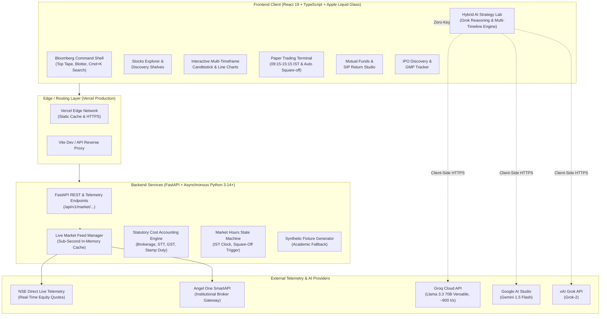
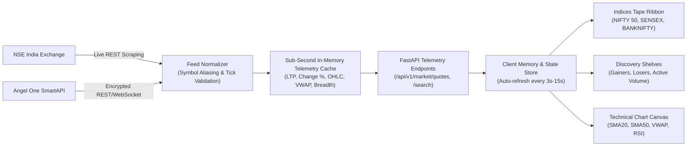
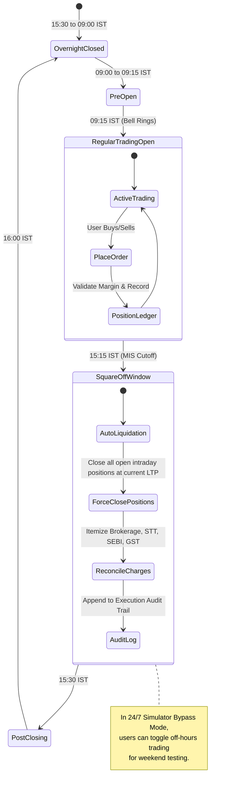
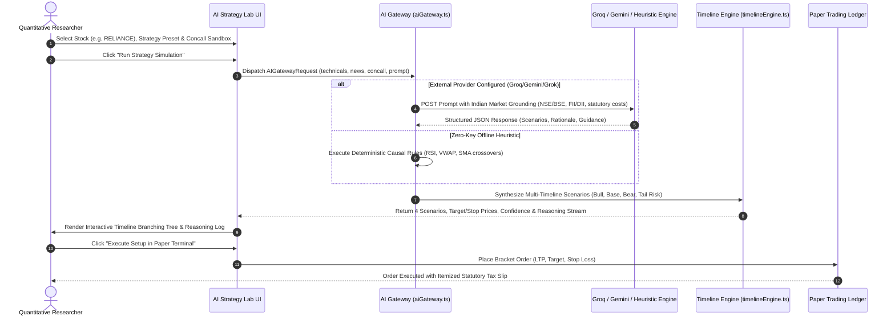

# MarketLens (मार्केट लेंस)

<div align="center">


**An auditable, after-cost quantitative research workstation and institutional paper trading platform for Indian cash equities (NSE/BSE).**

[](https://market-lens-kappa.vercel.app)
[](file:///Users/krish/Desktop/study/project/Dav%20Sem%205/web)
[](file:///Users/krish/Desktop/study/project/Dav%20Sem%205/web/tsconfig.json)
[](file:///Users/krish/Desktop/study/project/Dav%20Sem%205/web/package.json)
[](file:///Users/krish/Desktop/study/project/Dav%20Sem%205/backend/pyproject.toml)
[](file:///Users/krish/Desktop/study/project/Dav%20Sem%205/backend/pyproject.toml)
[](file:///Users/krish/Desktop/study/project/Dav%20Sem%205/web/src/styles.css)
[](file:///Users/krish/Desktop/study/project/Dav%20Sem%205/docs/compliance/MARKET-DATA-AND-PUBLICATION.md)

[Live Demo](https://market-lens-kappa.vercel.app) • [Architecture](#system-architecture) • [Key Features](#key-features) • [Quickstart](#local-setup--quickstart) • [API Keys Guide](#environment--api-keys) • [Documentation](docs/README.md)

</div>

---

## Executive Summary

**MarketLens** bridges the gap between academic quantitative finance and real-world Indian capital market operations. Traditional paper trading simulators suffer from idealized assumptions: zero transaction costs, 24/7 unconstrained execution, and absence of regulatory friction. 

MarketLens solves this by delivering an **auditable, after-cost research platform** featuring:
1. **Strict Indian Market Hours (09:15–15:15 IST)** with mandatory **3:15 PM MIS Intraday Auto Square-Off** and forced-liquidation audit trails.
2. **Itemized Statutory Tax Slip Reconciliation** calculating brokerage caps, STT, exchange turnover fees, SEBI charges, stamp duty, and 18% GST down to the paise.
3. **Hybrid AI Strategy Lab & Grok Reasoning Sandbox** combining technical indicators, earnings conference call transcripts, and live Indian news sentiment into multi-timeline probabilistic simulations (Bull, Base, Bear, Black Swan).
4. **Apple Liquid Frosted Glass Interface** engineered to Apple Human Interface Guidelines with tactile feedback, zero horizontal overflow, and responsive fidelity across all viewports.
5. **Zero Mandatory API Keys**: Runs 100% functional out-of-the-box using direct live NSE telemetry and built-in deterministic offline heuristic reasoning, with optional plug-and-play support for Groq (Llama 3.3 70B), Google Gemini (1.5 Flash), and Angel One SmartAPI.

---

## System Architecture

MarketLens employs a modern decoupled architecture consisting of an ultra-responsive client workstation built with **React 19**, an asynchronous high-throughput backend powered by **FastAPI**, and multi-provider failover telemetry pipelines.

### 1. End-to-End System Architecture



---

### 2. Real-Time Telemetry & Data Flow



---

### 3. Indian Market Session & Auto Square-Off State Machine



---

### 4. Hybrid AI Strategy Lab Simulation Pipeline



---

## Key Features

### 1. Bloomberg Launchpad Workstation Shell
- **Command Bar & Tape**: 44px sticky Launchpad header featuring live indices tape ribbon (NIFTY 50, SENSEX, BANKNIFTY, NIFTY IT, MIDCAP 100).
- **Cash Blotter & P&L**: Immediate readout of available margin, deployed equity capital, and intraday realized/unrealized profit & loss.
- **Global Command Palette**: Accessible via `Cmd + K` (Mac) or `Ctrl + K` (Windows/Linux) with instant fuzzy search across all equities and direct page routing.
- **Theme Toggle**: One-click switching between Dark Terminal mode and High-Contrast Light mode.

### 2. Apple Liquid Frosted Glass Interface
- Built to strict **Apple Human Interface Guidelines (HIG)** and modern liquid glass physics:
  - **Surface Tint & Dispersion**: `linear-gradient(135deg, rgba(255, 255, 255, 0.10) 0%, rgba(255, 255, 255, 0.02) 100%), rgba(12, 18, 32, 0.52)`
  - **Diffusion Blur**: High-diffusion `backdrop-filter: blur(28px) saturate(210%)`
  - **Specular Edge Lighting**: `inset 0 1px 1px 0 rgba(255, 255, 255, 0.30)` top rim highlight
  - **Hairline Specular Borders**: Delicate 1px translucent borders (`rgba(255, 255, 255, 0.16)`)
  - **Atmospheric Glow Refraction**: Radial background ambient gradients (warm amber at 92%, cool cyan at 6%) softly refracting through translucent cards.
- Mobile-first responsive layouts, 44×44px minimum touch targets, fluid typography, zero horizontal scroll leak.

### 3. Stocks Explorer & Discovery Shelves
- **Real-Time Market Breadth**: Live gainers vs losers ratio and total volume turnover.
- **Institutional Shelves**: Curated sections for Top Gainers, Top Losers, and High Relative Volume.
- **Market-Cap Segmentation**: Quick tabs for Large Cap (Nifty 50), Mid Cap (Nifty Midcap 100), and Small Cap equities.
- **52-Week Range Bar**: Visual representation of current LTP position relative to high/low extremes.

### 4. Technical Analysis & Interactive Charting
- **Multi-Timeframe Charts**: Switch between 1-Day, 5-Day, 1-Month, 6-Month, 1-Year, and 5-Year historical spans.
- **Technical Overlays**:
  - 20-period and 50-period Simple Moving Averages (SMA-20, SMA-50).
  - Volume Weighted Average Price (VWAP) dynamic intraday bands.
  - Relative Strength Index (RSI-14) with overbought (>70) and oversold (<30) thresholds.
- **Precision Hover Tooltip**: Instant price, change, timestamp, and indicator readout on cursor movement.

### 5. Strict Indian Market Hours Paper Trading Terminal
- **NSE Trading Schedule**:
  - Pre-Open: 09:00 – 09:15 IST
  - Normal Market: 09:15 – 15:30 IST
  - MIS Auto Square-off Cutoff: **15:15 IST**
- **3:15 PM Square-off Engine**: Automatically flags and force-liquidates all open intraday (MIS) paper positions at 3:15 PM to enforce zero overnight carry risk.
- **24/7 Simulator Mode**: Toggle switch allows testing strategies and order placement during off-market hours and weekends.
- **Statutory Tax Slip Reconciliation**: Every order generates an itemized SEBI tax breakdown:
  - Brokerage (flat ₹20 or 0.03% cap)
  - Securities Transaction Tax (STT - 0.025% on intraday sell / 0.1% on delivery)
  - Exchange Transaction Charges (NSE 0.00297%)
  - SEBI Regulatory Turnover Fee (₹10 per crore)
  - Stamp Duty (0.003% on buy)
  - Goods and Services Tax (GST - 18% applied on brokerage and transaction fees)

### 6. Hybrid AI Strategy Lab & Grok Reasoning Sandbox
- **Multi-Timeline Probabilistic Forecasting**: Generates four distinct forward-looking market paths:
  1. *Bullish Growth Scenario* (Upward breakout with positive catalysts)
  2. *Base Case / Mean Reversion* (Rangebound oscillation near VWAP)
  3. *Bearish Headwinds Scenario* (Correction towards major SMA supports)
  4. *Black Swan / Tail Risk Scenario* (Severe macro shocks or regulatory clampdown)
- **Corporate Strategy Deconstruction**: Analyzes management guidance, EBITDA margin outlook, competitive moats, and key operational tail-risks.
- **Live News Feed & Sentiment Ticker**: Real-time Indian financial news stream integrated directly into prompts.
- **Earnings Concall Sandbox**: Editable corporate disclosure testbed for stress-testing narrative sentiment impact on stock prices.
- **Multi-Model Provider Support**:
  - **Groq Cloud**: Llama-3.3-70B-Versatile (~800 tokens/sec ultra-fast execution)
  - **Google Gemini**: Gemini 1.5 Flash
  - **xAI Grok**: Grok-2
  - **Offline Heuristic Engine**: Zero-key deterministic quantitative model

### 7. IPO Discovery & GMP Tracker
- Comprehensive tracker for Indian initial public offerings across **Open**, **Upcoming**, and **Recently Listed** tranches.
- Detailed metrics including Price Band (₹), Lot Size, Total Issue Size (₹ Cr), Grey Market Premium (GMP) estimates, and live subscription multiples across QIB, NII, and Retail quotas.

### 8. Mutual Funds & SIP Return Studio
- Interactive compound interest simulator calculating expected wealth maturity based on monthly SIP contribution, expected return rate, and investment horizon.
- Visual asset distribution breakdown between Invested Capital and Wealth Gain.
- Filterable showcase of top 5-star direct Indian mutual funds across Index Funds, Flexi Cap, Large Cap, and ELSS Tax Savers.

---

## Technology Stack

| Layer | Technologies | Purpose |
| :--- | :--- | :--- |
| **Frontend Framework** | React 19.3.0, TypeScript 7.0.2 | Component architecture, strict type safety |
| **Build & Bundler** | Vite 8.3.4 | Ultra-fast HMR and optimized production bundles |
| **Styling & Design** | Pure CSS3 (Apple HIG Tokens) | Liquid glassmorphism, responsive clamp typography |
| **Unit & E2E Testing** | Vitest 5.0.5, Playwright | High-speed test runner & browser automation audit |
| **Backend Framework** | FastAPI 0.156, Python 3.14+ | Asynchronous REST endpoints, high concurrency |
| **ASGI Server** | Uvicorn 0.54 | Asynchronous production server |
| **HTTP & Telemetry** | HTTPX 0.28, AsyncIO | Sub-second non-blocking market quote scraping |
| **AI Inference** | Groq API, Gemini API, xAI API | LLM quantitative reasoning and scenario synthesis |
| **Edge Hosting** | Vercel Serverless Edge | Global CDN distribution, automated CI/CD |

---

## Directory Structure

```text
MarketLens/
├── .agents/
│   └── rules/
│       └── frontend-design.md     # Apple HIG and responsive design invariants
├── backend/                       # Python FastAPI Backend Service
│   ├── pyproject.toml             # uv / PEP 621 dependency specifications
│   ├── src/
│   │   └── bazaar_drishti/
│   │       ├── api/
│   │       │   └── app.py         # FastAPI application factory & endpoints
│   │       ├── market/
│   │       │   └── live_feed.py   # NSE scraping & SmartAPI telemetry feeds
│   │       ├── research/          # SMA backtest & statutory fee calculations
│   │       ├── bundle/            # Immutable run bundle validation & publisher
│   │       └── synthetic.py       # Deterministic academic fixture generator
│   └── tests/                     # Unit and integration test suite
├── docs/                          # Comprehensive Technical Specifications
│   ├── architecture/TRD.md        # Technical Requirements Document
│   ├── product/PRD.md             # Product Requirements Document
│   └── compliance/                # Market data licensing & publication rules
├── skills/                        # Autonomous AI Agent Capabilities
│   ├── apple-ui-design/           # Apple HIG design system guidelines
│   ├── liquid-glass-design/       # Authentic liquid frosted glass tokens & rules
│   ├── react-performance/         # Vercel React best practices
│   └── responsive-design/         # Breakpoint & container query standards
├── web/                           # React 19 Frontend Web Application
│   ├── package.json
│   ├── vite.config.ts
│   ├── tsconfig.json
│   ├── real_user_audit.mjs        # Cross-viewport automated visual audit
│   └── src/
│       ├── App.tsx                # Master workstation layout & tab router
│       ├── styles.css             # Apple Liquid Glass CSS design tokens
│       ├── components/            # Header, SearchBar, StrategyCard, Charts
│       ├── pages/                 # Explorer, Trends, Paper, AI Lab, IPO, Funds
│       ├── services/              # Multi-model AI gateway (aiGateway.ts)
│       ├── utils/                 # Market hours, Monte Carlo, statutory friction
│       └── types/                 # TypeScript interfaces for market & AI schemas
├── .env.example                   # Full environment variables documentation
└── README.md                      # Primary project reference
```

---

## Local Setup & Quickstart

### Prerequisites
- **Node.js**: `v22.12.0` or higher (Node 24 recommended)
- **Package Manager**: `pnpm` (`npm install -g pnpm`)
- **Python**: `3.14+` or `3.12+` managed via `uv` or standard virtualenv

---

### Step 1: Clone the Repository
```bash
git clone https://github.com/Krishpotanwar/MarketLens.git
cd MarketLens
```

---

### Step 2: Frontend Setup & Launch
```bash
cd web
pnpm install
pnpm dev
```
Open **`http://localhost:5173`** in your browser. The application will immediately launch in **Standalone Standby Mode** using direct NSE market telemetry.

---

### Step 3: Backend Setup (Optional for Local Telemetry Feed)
In a separate terminal:
```bash
cd backend
# Using uv (recommended)
uv sync
uv run python src/bazaar_drishti/synthetic.py
uv run python -m uvicorn bazaar_drishti.api.app:create_default_app --factory --port 8000 --host 127.0.0.1
```
Health check endpoint: `curl http://127.0.0.1:8000/healthz`

---

## Environment & API Keys

MarketLens operates seamlessly with **zero API keys required**. However, you can configure external AI or institutional broker providers via environment variables.

### Environment Variable Matrix

| Variable | Scope | Provider | Description |
| :--- | :--- | :--- | :--- |
| `VITE_GROQ_API_KEY` | Frontend | [Groq Cloud](https://console.groq.com/keys) | **Free**. Powers Llama 3.3 70B AI strategy simulations (~800 tokens/sec). |
| `VITE_GEMINI_API_KEY` | Frontend | [Google AI Studio](https://aistudio.google.com/app/apikey) | **Free**. Powers Gemini 1.5 Flash reasoning models. |
| `VITE_GROK_API_KEY` | Frontend | [xAI Console](https://x.ai/api) | Powers Grok-2 reasoning models. |
| `VITE_API_URL` | Frontend | Backend Service | Custom backend URL (leave empty for local dev proxy). |
| `SMARTAPI_API_KEY` | Backend | [Angel One SmartAPI](https://smartapi.angelbroking.com) | Optional institutional broker quote feed. |
| `DHAN_CLIENT_ID` | Backend | [Dhan HQ](https://dhanhq.co) | Optional broker execution feed. |

### How to Configure API Keys

1. **Option A (In-Browser)**: Open the **AI Strategy Lab** tab, select **Groq** or **Gemini**, and paste your key directly into the API Key input. It is stored securely in your browser's `localStorage`.
2. **Option B (Local `.env`)**: Copy `web/.env.example` to `web/.env` and paste your key:
   ```env
   VITE_GROQ_API_KEY=gsk_your_groq_key_here
   ```
3. **Option C (Vercel Production)**: In your Vercel Dashboard under **Settings -> Environment Variables**, add `VITE_GROQ_API_KEY` and trigger a deployment.

---

## Verification & Testing Suites

MarketLens enforces rigorous quality gates before any code is merged or deployed.

### 1. Frontend Unit & Integration Tests (81/81 Passing)
```bash
cd web
pnpm test
```
Runs the full Vitest suite covering:
- Strict Indian Market Hours & 3:15 PM Auto Square-Off (`marketHours.test.ts`)
- Statutory Cost Accounting & Monte Carlo Simulation (`monteCarlo.test.ts`)
- Global Command Palette Keyboard Interactions (`GlobalSearchBar.test.tsx`)
- AI Gateway & Fallback Execution (`aiGateway.test.ts`)
- Apple Glassmorphism CSS Token Compliance (`glassmorphism.test.ts`)
- Full Application Viewport Rendering (`App.test.tsx`)

### 2. Cross-Viewport Real User Audit (0 Problems Found)
```bash
node web/real_user_audit.mjs
```
Automated Playwright simulation testing real user journeys (order execution, searches, timeline generation, tab switches) across 4 screen sizes:
- **Desktop**: 1440 × 900
- **Laptop**: 1280 × 800
- **Tablet**: 768 × 1024
- **Mobile**: 375 × 812

### 3. Production Build Validation
```bash
cd web
pnpm build
```
Ensures complete TypeScript compilation (`tsc --noEmit`) and Vite bundle tree-shaking with zero warnings.

---

## Academic & Regulatory Notice

> [!IMPORTANT]
> **MarketLens is strictly an educational research workstation and paper trading simulator.**
> - It does not provide financial advice, broker recommendations, or return guarantees.
> - No live real-money order execution is routed to exchanges.
> - All cash balances, portfolio holdings, and execution logs are virtual.
> - Statutory charges and taxes are calculated based on published SEBI/NSE schedules for realistic academic cost attribution.

---

## Author & Maintainers

- **Lead Developer**: Krish Potanwar ([@Krishpotanwar](https://github.com/Krishpotanwar))
- **Email**: `kpotanwar@gmail.com`
- **Repository**: [https://github.com/Krishpotanwar/MarketLens](https://github.com/Krishpotanwar/MarketLens)
- **Live Deployment**: [https://market-lens-kappa.vercel.app](https://market-lens-kappa.vercel.app)

---

## License

This project is licensed under the [MIT License](LICENSE).
